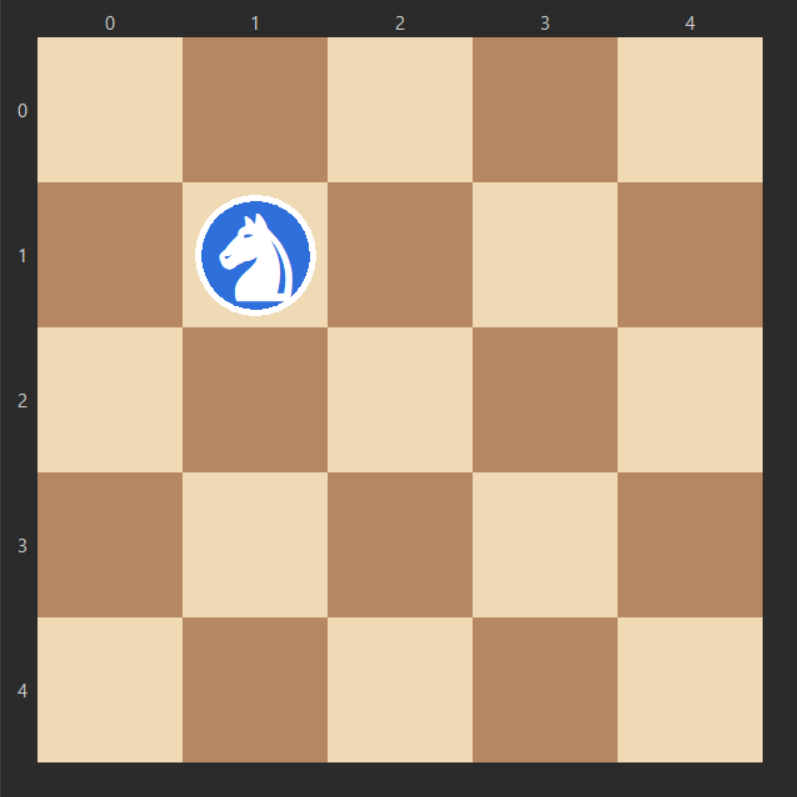
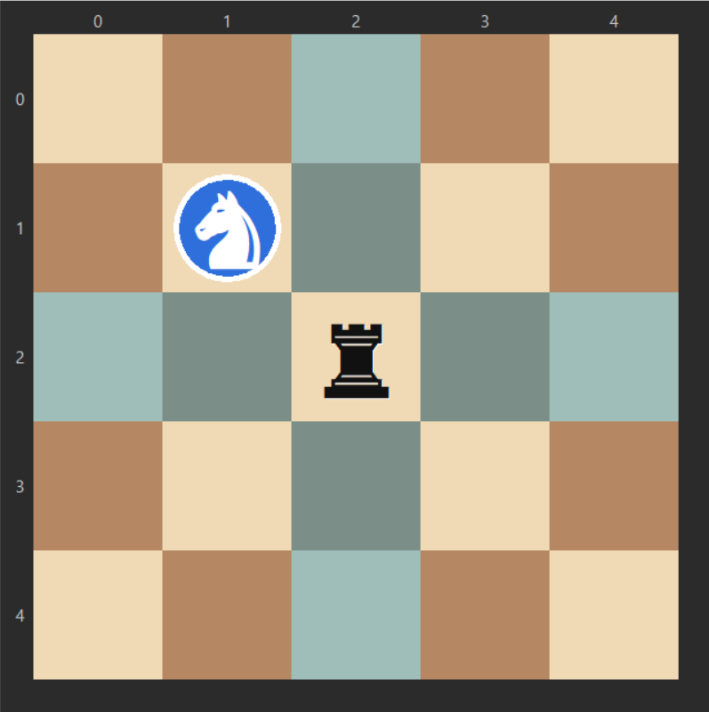
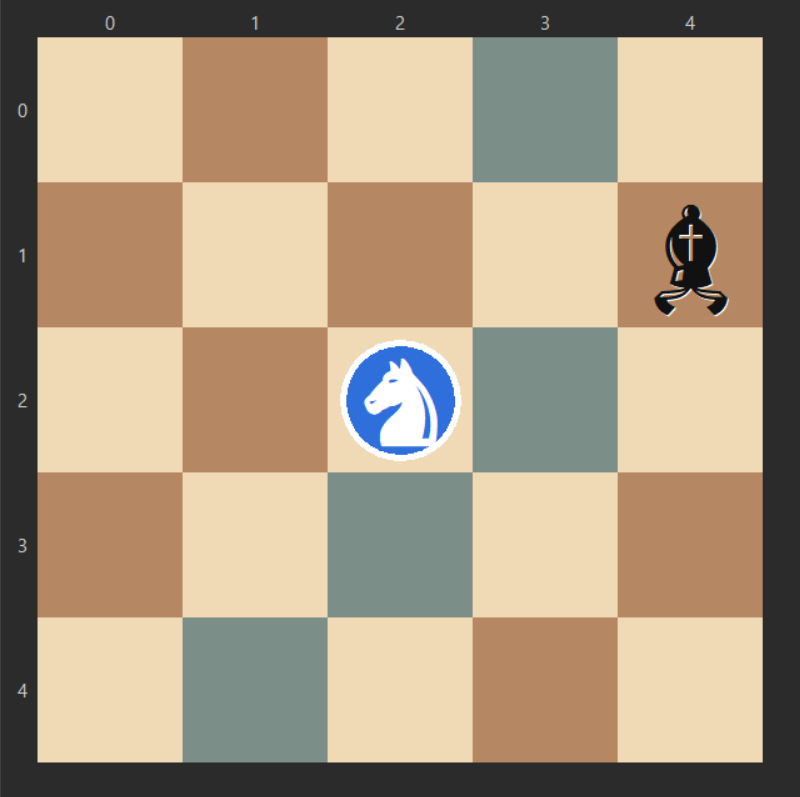
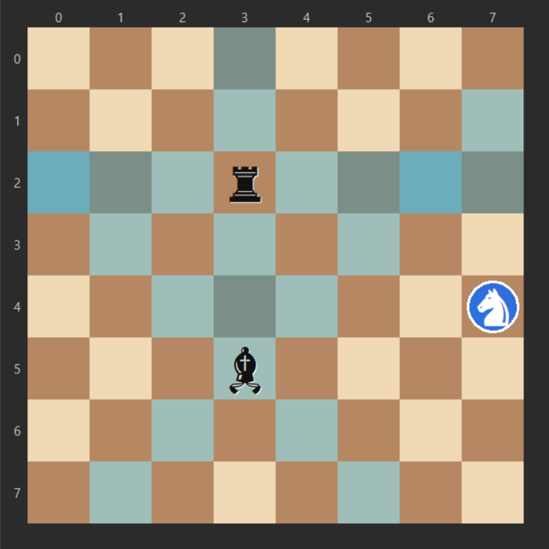
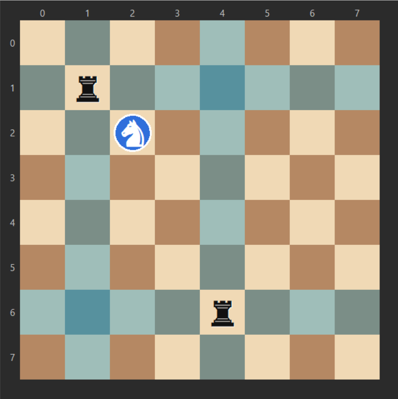

# **Knight Tour Problem pada Papan Catur 5x5 Menggunakan Algoritma** **_Breadth First Search, Greedy,_ A*** dan **_Capturable Obstacles_** 

| Nama | NRP |
| :--- | :--- |
| Faris Rashid Azizi | (5025251099) |
| Yudhistira Eka Pratama | (5025251136) |
| Raffa Atha Maulana | (5025251145) |
| Muhammad Azka Asyrafany | (5025251131) |
| Budiman Setiono | (5025251126) |

## **A. Problem** 

- **a. Latar Belakang Masalah** 

_Knight’s tour_ merupakan masalah kombinatorial yand didasari oleh bidak kuda dari permainan catur. Tujuan dari _knight’s tour_ adalah untuk mencari urutan gerakan dari kuda sedemikian agar bidak tersebut mengunjungi  seluruh kotak pada papan catur tepat satu kali. 

Terdapat dua variasi knight’s tour: 

- _Open tour_ : Bidak kuda mengunjungi seluruh kotak. 

- _Closed tour_ : Selain mengunjungi seluruh kotak, kuda harus kembali ke kotak awal. 

Laporan ini hanya akan mengamati varian _open tour._ 

Pada konsisi atau _state_ awal, akan diberikan sebuah papan catur berukuran _nxn._ Bidak kuda akan secara acak diletakkan pada salah satu kotak di papan catur. Menggunakan peraturan pergerakan bidak kuda pada permainan catur, kuda harus mengunjungi seluruh kotak pada papan. 

Akan diamati tiga tingkat kesulitan dalam _knight’s tour problem_ : 

- Level 1 

Pada level 1, diinisialisasi papan catur berukuran 5x5 dengan bidak kuda 

diletakkan secara acak pada papan. 

**Gambar 1.1  Board Level 1** 

- Level 2 

Seperti pada level 1, diinisialisasi sebuah papan catur berukuran 5x5 dengan bidak kuda. Namun pada level ini diperkenalkan sebuah _constraint_ tambahan. Satu bidak tambahan yaitu bidak gajah atau benteng diletakkan secara acak pada 

papan. Bidak ini akan memperkenalkan _attack squares_ yang mengikuti jalur serangan dari bidak gajah dan benteng pada permainan catur. Kuda tidak bisa menempati _attack squares_ , namun kuda dapat memakan _obstacle piece_ tersebut dan membebaskan _attack squares_ dan memberikan pilihan lebih untuk kuda. 

_Note: saat peletakkan, kuda tidak bisa ditempatkan pada attack squares atau kotak yang sudah ada bidaknya._ 

            

**Gambar 1.2  Level 2** 

- Level 3 

Pada level ini, diinisialisasi papan catur dengan ukuran 8x8 dengan satu kuda dan dua _obstacle piece._ 

_Note: kedua obstacel piece selalu berada dalam kotak yang berbeda, jika suatu obstacle piece dapat menghalangi jalur serangan obstacle piece lain._ 

            

**Gambar 1.3  Level 3** 

